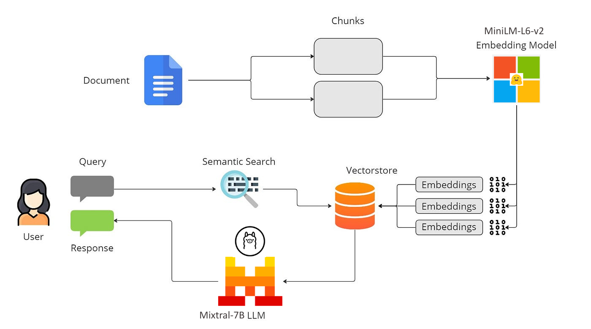

# CancerAssist

A Streamlit app that combines three cancer tools in one place:

1. **OncoBot** – RAG chatbot for breast cancer and melanoma questions (MiniLM embeddings, FAISS, Mistral via Ollama)
2. **OncoScanSkin** – MobileNetV2 CNN that labels skin lesion images as benign or malignant
3. **OncoTypeBC** – Random Forest that predicts breast cancer subtype from multi-omic features ([repo](https://github.com/fuzrohdah/OncoTypeBC))



## Files
- `app.py` – Streamlit app
- `rag_chatbot.ipynb` – builds the FAISS index from PDF sources
- `skin_cnn.ipynb` – trains the skin lesion CNN
- `melanoma_mobilenet.h5` – trained CNN

## Run
```bash
pip install -r requirements.txt
streamlit run app.py
```
Needs Ollama with `mistral`, plus `faiss_index/`, `rf_model.pkl` and `final_merged_df.csv` in this folder.

For research and learning only, not for clinical use.
